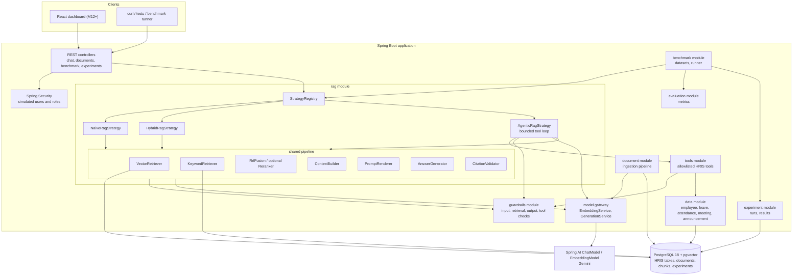
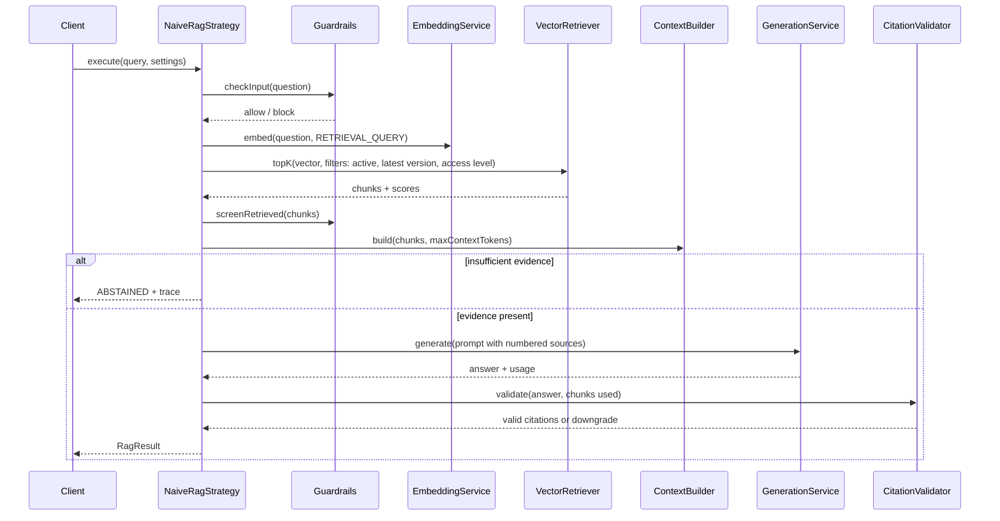
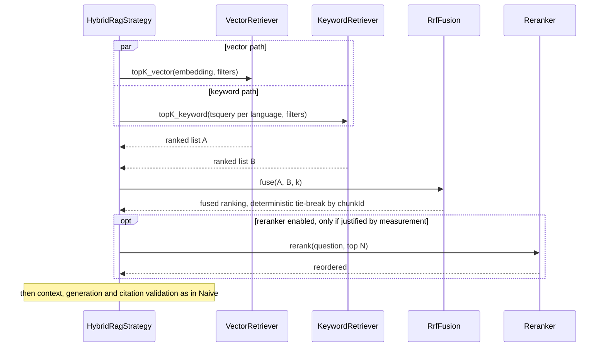
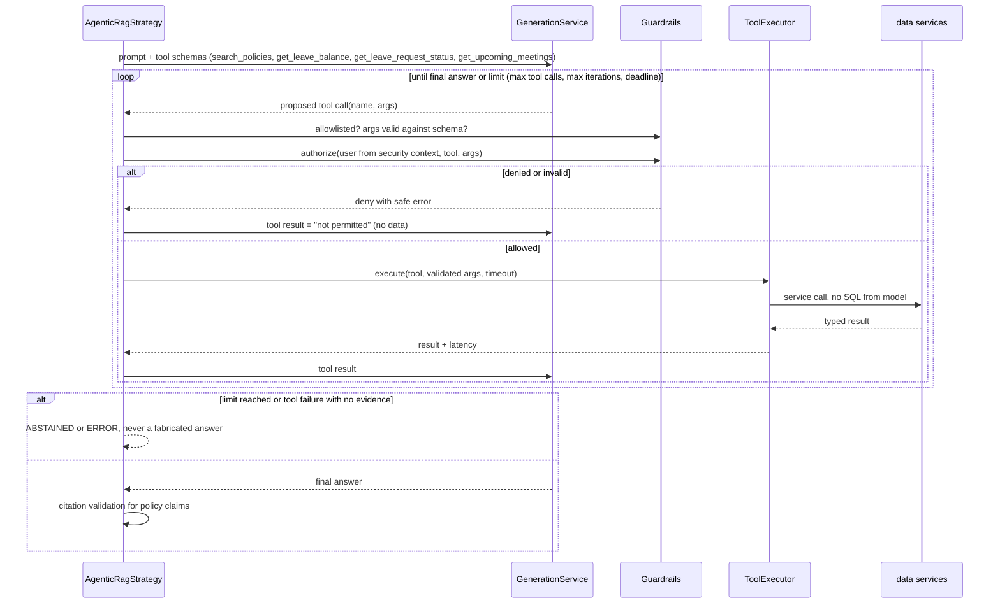

# Architecture

> Status: **design agreed, not yet implemented.**
> §1 (stack) was verified in Task 0.1. §2–§9 (design) were written in Task 0.2.
> Class and record names in §4–§6 are design targets. They become verified facts only once implemented and tested.
> Database design (ERD), detailed API endpoints and the risk register are in Task 0.3.

## 1. Technology stack: verified versions and decisions (Task 0.1, 2026-11-10)

### 1.1 Verification method

I built a throwaway Maven project (outside the repository) with the same parent and BOM as `pom.xml`. I ran a
`@SpringBootTest` + Testcontainers test against the pinned pgvector image. A separate temporary container ran a
full-text-search probe. None of the repository's code or config was changed.

### 1.2 Resolved versions (from `mvn dependency:tree`)

| Component | Artifact | Resolved version | Status |
|---|---|---|---|
| Spring Boot | `spring-boot-starter-parent` | 4.1.2 | PASS |
| Spring AI BOM | `spring-ai-bom` | 2.0.1 | PASS |
| Gemini chat | `spring-ai-starter-model-google-genai` | 2.0.1 (Google `google-genai` SDK 1.65.0) | PASS (context/bean creation) |
| Gemini embeddings | `spring-ai-starter-model-google-genai-embedding` | 2.0.1 | PASS (context/bean creation) |
| JPA / Hibernate | `spring-boot-starter-data-jpa` | Hibernate ORM 7.4.13.Final | PASS (`ddl-auto=validate`) |
| Flyway | `spring-boot-starter-flyway` + `flyway-database-postgresql` | 12.4.0 | PASS (migration applied) |
| PostgreSQL JDBC | `org.postgresql:postgresql` | 42.7.14 | PASS |
| pgvector Java types | `com.pgvector:pgvector` | 0.1.6 | resolved (optional) |
| Actuator | `spring-boot-starter-actuator` | 4.1.2 | PASS (`/actuator/health` → 200 `UP`) |
| Testcontainers | `spring-boot-testcontainers`, `testcontainers-postgresql`, `testcontainers-junit-jupiter` | 2.0.5 | PASS |
| Database image | `pgvector/pgvector:0.8.7-pg18-bookworm` | PostgreSQL 18.6, pgvector 0.8.7 | PASS |
| JDK on dev machine | Oracle JDK | 24.0.2 (compiling with `release 21`) | PASS. JDK 21 install optional |

Notes:
- Testcontainers 2.x uses new artifact names (`testcontainers-postgresql`) and package names
  (`org.testcontainers.postgresql.PostgreSQLContainer`).
- Spring Boot 4 uses modular starters: `spring-boot-starter-flyway` must be declared explicitly, and the test starters are
  per-technology (`spring-boot-starter-webmvc-test`, etc.).
- Boot 4 uses Jackson 3 (`tools.jackson.*` packages).
- Mockito warns about inline-mock-maker self-attach on JDK 24. Configure Mockito as a `-javaagent` in surefire during Milestone 1.

**Decision D1: keep Spring Boot 4.1.2 + Spring AI 2.0.1.** No compatibility blocker was found across Gemini, PostgreSQL,
Flyway, Testcontainers and Actuator. (This replaces the spec's "Spring Boot 3.x"; approved in principle by the user, conditional on this verification.)

### 1.3 Database capabilities verified

- `CREATE EXTENSION vector`, a `vector(768)` column, an HNSW index (`vector_cosine_ops`), and cosine distance (`<=>`) all work. PASS.
- A generated `tsvector` column with a GIN index, plus `@@` queries, works. PASS.
- Available extensions: `vector 0.8.7`, `pg_trgm 1.6`, `unaccent 1.1`.

**Decision D2: Flyway owns the entire schema.** That means `spring.jpa.hibernate.ddl-auto=validate` and the Spring AI pgvector
`initialize-schema=false` (or the pgvector store starter is removed; to be decided in Task 0.2).

### 1.4 Arabic / English full-text search findings (PostgreSQL 18.6)

PostgreSQL ships an `arabic` Snowball configuration. Results on sample HR policy sentences:

| Query | Language config | Result | Note |
|---|---|---|---|
| `الإجازة السنوية` (MSA) | arabic | match | stems → `اجاز`, `سنو` |
| `الإجازات` (plural) | arabic | match | plural folded |
| `اجازة` / `أجازة` / `اجازه` | arabic | match | hamza variants normalized; taa-marbuta→haa only **without** the "ال" prefix |
| `الاجازه` / `المرضيه` (ال + haa) | arabic | **no match** | *Added in Task 0.3:* stems to `اجازه` / `مرضيه`, not `اجاز` / `مرض`. See `database-design.md` §5 |
| `الإِجَازَة` (diacritics) | arabic | match | diacritics stripped |
| `التأخير` | arabic | match | |
| `تأخر` (verb) vs doc `التأخير` | arabic | **no match** | derivational forms not unified (`تاخر` ≠ `تاخير`) |
| `اتأخرت` (Egyptian) | arabic | **no match** | dialect morphology not handled |
| `محتاج أقدم إجازة` (Egyptian) | arabic | **no match** | `plainto_tsquery` is AND; `أقدم` ≠ `تقديم` |
| `عيان` (Egyptian for "sick") | arabic | **no match** | lexical gap (dialect vocabulary) |
| `سياسة remote work` (mixed) | arabic | **no match** | AND semantics; English words not stemmed under `arabic` |
| `annual leave` vs Arabic doc | any | no match | expected; no cross-lingual matching in FTS |
| `leave request` / `requesting leaves` | english | match | English stemming OK |
| `work from home` vs "Remote work" doc | english | **no match** | no synonyms |
| Stop-words `على`, `من` | arabic | **kept** | the `arabic` config has no stop-word list |

**Conclusions (inputs to Milestone 7, not yet decisions):**
1. FTS is useful for **same-language, MSA/English lexical matches** only. Cross-lingual and dialect recall must come from vector search.
2. Each chunk's `tsvector` should use the document's language config (`arabic` / `english`). The query side needs language
   detection, or should query both configs.
3. Use OR-style tsqueries for hybrid recall, not `plainto_tsquery` AND semantics. *(Not yet tested.)*
4. Stop-words and dialect normalization may need a custom dictionary or pre-normalization step. Measure first in Milestone 7.

### 1.5 Gemini provider

**Decision D3:** Gemini is the first chat and embedding provider. It sits behind Spring AI's `ChatModel` / `EmbeddingModel`
interfaces, configured with `spring.ai.google.genai.*` properties (verified names: `api-key`,
`chat.options.model`, `embedding.api-key`, `embedding.text.options.model`, `embedding.text.options.dimensions`,
`embedding.text.options.task-type`). The API key comes only from the `GOOGLE_API_KEY` environment variable.

Live verification on 2026-11-10 used the account's key, loaded from the git-ignored `.env` and sent only in a request header.
The key was not found in any log or doc (scanned).

| Check | Status |
|---|---|
| Spring AI Gemini chat and embedding beans auto-configure under Boot 4.1.2 | PASS |
| Model listing via `v1beta/models` (AI Studio / Gemini Developer API key; Vertex mode not needed) | PASS |
| `gemini-3.5-flash-lite` available and callable through Spring AI `ChatModel` | PASS |
| `gemini-embedding-001` returns 768-dim vectors for EN and AR through Spring AI `EmbeddingModel` | PASS |
| Cross-lingual similarity sanity check | PASS (numbers below; a sanity check only, not a benchmark) |

**Embedding models available:** `gemini-embedding-001`, `gemini-embedding-2`, `gemini-embedding-2-preview`.

**Chat models relevant to this project (subset of the account list):** `gemini-3.5-flash-lite`, `gemini-3.5-flash`,
`gemini-3.6-flash`, `gemini-3.7-flash`, `gemini-3.8-flash`, `gemini-3.1-flash-lite`, `gemini-2.5-flash`, `gemini-2.5-flash-lite`, `gemini-2.5-pro`,
`gemini-3.1-pro-preview`.

**One-word chat probe ("Reply with exactly one word: OK"), single call each:**

| Model | Latency | Prompt / completion / thinking / total tokens |
|---|---|---|
| `gemini-3.5-flash-lite` | 1587 ms | 8 / 1 / none / 9 |
| `gemini-3.5-flash` | 2323 ms | 8 / 0 / 94 / 102 |
| `gemini-2.5-flash` | 1670 ms | 8 / 1 / 14 / 23 |

Single calls only: these are indicative, not latency benchmarks.

**Cosine similarity, `gemini-embedding-001` @ 768 dims (one sentence each):**

| Pair | Cosine |
|---|---|
| EN leave rule ↔ AR (MSA) translation | 0.8782 |
| Egyptian Arabic leave question ↔ MSA leave rule | 0.7486 |
| EN leave rule ↔ EN unrelated (cafeteria) | 0.5618 |
| AR leave rule ↔ EN unrelated (cafeteria) | 0.5446 |

Cross-lingual pairs score clearly above unrelated pairs. Note the high similarity "floor" (~0.55 for unrelated text): an
absolute score cutoff for abstention will need calibration against the benchmark, not a guessed threshold.

**Decision D5 (approved 2026-11-10): baseline models**
- Chat / generation: **`gemini-3.5-flash-lite`**. It is available, had the lowest latency in the probe, and uses no thinking tokens by default,
  which keeps cost and token metrics predictable across strategies. `gemini-3.5-flash` remains a candidate for Agentic tool selection
  if flash-lite proves weak there. Switch only on measured evidence.
- Embeddings: **`gemini-embedding-001` @ 768 dims**. `gemini-embedding-2` is a candidate for a dedicated embedding-model
  comparison experiment after the benchmark exists (it requires re-embedding the corpus; dimension stays configurable).
- Token accounting must capture `thoughtsTokenCount` separately: thinking models bill thinking tokens that are not in the completion count.

### 1.6 Infrastructure decision (applied in Task 1.1, 2026-11-10)

**Decision D4:** Docker Compose resources are renamed to avoid conflict with the existing `invoice-ai-db` container from another
project: container `hris-rag-db`, database `hris_rag`, user `hris_user`, host port `5434`, and a separate named volume. The image stays
`pgvector/pgvector:0.8.7-pg18-bookworm`.

---

## 2. Component view

A **modular monolith**: one Spring Boot process and one PostgreSQL database. Each module is layered internally
(controller → service → repository).



Responsibilities in one line each:

| Module | Owns | Must not |
|---|---|---|
| `document` | Load → extract → normalize → chunk → embed → store; ingestion status and failures | Answer questions |
| `rag` | Strategy contract, the three strategies, shared retrieval / context / generation / citation pipeline | Read benchmark labels |
| `guardrails` | Input validation and length limits, per-user rate limiting, suspicious-request detection, retrieval filters (status/version/access), injection screening, output and citation checks | Call the LLM to decide authorization |
| `tools` | Allowlisted tool definitions, input schemas, authorization at execution, limits | Run SQL directly or accept SQL |
| `data` | Synthetic HRIS entities, repositories, read services, deterministic seed generator | Depend on `rag` |
| `evaluation` | Metric calculations (retrieval, answer, latency, cost, security) | Call strategies |
| `benchmark` | Benchmark datasets and cases, runner that calls strategies and then evaluation | Pass labels into `RagQuery` |
| `experiment` | Persisting run config, per-question results and aggregates | Compute metrics |
| model gateway (`rag.model`) | Embedding and chat calls, usage, timing, timeouts | Contain business rules |

## 3. Package structure and dependency rules

Root package: **`com.mimocodes.hrisrag`**. The existing `com.mimocodes.HRISRag` is renamed to lowercase in Milestone 1.

```text
com.mimocodes.hrisrag
├── config          # @ConfigurationProperties records, Security, beans
├── common          # small shared value types (Language, Timings, ids)
├── exception       # global ProblemDetail handler, base exceptions
├── document        # controller, service, repository, entity, dto, ingestion
├── rag
│   ├── controller  # chat / playground API
│   ├── service     # StrategyRegistry, request tracing
│   ├── strategy    # RagStrategy + Naive / Hybrid / Agentic
│   ├── retrieval   # VectorRetriever, KeywordRetriever, RrfFusion, Reranker
│   ├── prompt      # templates and PromptRenderer
│   ├── model       # EmbeddingService, GenerationService (model gateway)
│   └── citation    # citation extraction and validation
├── data            # employee, attendance, leave, meeting, announcement (+ seed)
├── tools
├── guardrails
├── evaluation
├── benchmark
└── experiment
```

**Dependency rules** (enforced by an ArchUnit test, added in Milestone 2 when the first module classes exist; decision D9):

1. A module uses another module only through its `service` classes and `dto` types. It never uses another module's `repository` or `entity`.
2. `benchmark → rag, evaluation, experiment`. Nothing depends on `benchmark`.
3. `rag` depends on neither `benchmark` nor `evaluation`, which keeps labels out of the answering path structurally.
4. `tools → data` services only. No `JdbcTemplate` or `EntityManager` in `tools`.
5. `data` depends on no other feature module.
6. Controllers contain no business logic. Services do not return entities from the API.

ArchUnit was chosen over Spring Modulith (D9). We only need import rules, and Modulith brings events and module APIs we
don't need yet.

## 4. Model-provider abstraction (D8)

Spring AI's `ChatModel` and `EmbeddingModel` already are the vendor abstraction. Adding our own `LlmProvider` interface on
top would duplicate it, so we don't. Instead, two thin project services sit between our code and Spring AI and own the
things Spring AI doesn't do for us:

| Service | Responsibilities |
|---|---|
| `EmbeddingService` | Batch embedding (configurable batch size). Task type `RETRIEVAL_DOCUMENT` for chunks and `RETRIEVAL_QUERY` for questions (Spring AI exposes `GoogleGenAiTextEmbeddingOptions.TaskType`). Check vector length = configured schema dimension. Count calls and record latency. Wrap provider errors. |
| `GenerationService` | Call `ChatModel` with explicit options (model ID, temperature, max tokens). Enforce a timeout. Return text plus a `ModelCall` record: model ID, latency, prompt / completion / **thinking** tokens, finish reason. |

Configuration (bound to an `@ConfigurationProperties` record):

```yaml
hrisrag:
  models:
    chat-model: gemini-3.5-flash-lite
    temperature: 0.0          # benchmark default; deterministic as possible
    max-output-tokens: 1024
    timeout: 30s
    embedding-model: gemini-embedding-001
    embedding-dimensions: 768
    embedding-batch-size: 50
```

Only Gemini-specific details (the task-type enum, the usage subclass) are allowed inside `rag.model`. Switching provider means
changing the starter, the config, and these two classes. Strategies and the benchmark are untouched.

## 5. Vector storage access (D6)

We do **not** use Spring AI's `PgVectorStore`. Chunks live in our own Flyway-managed table, accessed with `JdbcTemplate`.
The full design is in Task 0.3 / `database-design.md`; in outline:

- `document_chunk` holds `embedding vector(768)`, `content`, `language`, `search_vector tsvector`, plus the metadata that
  citations and filters need (document ID, version, section, access level, active status).
- One SQL statement does vector top-K **and** metadata filtering (status, version, access level) inside the database, so
  restricted chunks never reach application memory or the LLM.
- The keyword query uses the chunk's language config (`arabic` / `english`), based on the §1.4 findings.

Reason: Hybrid search, filtering before ranking, and citation metadata all need full SQL control, which `PgVectorStore`'s
generic metadata JSON doesn't give cleanly. Cost: we maintain the retrieval SQL ourselves (small, and covered by integration tests).
Consequence: `spring-ai-starter-vector-store-pgvector` is removed from `pom.xml` in Milestone 1.

## 6. RAG strategy contract

All strategies implement one interface. The chat API and the benchmark runner call strategies the same way, so their results
are directly comparable.

```java
public interface RagStrategy {
    StrategyId id();                                   // NAIVE, HYBRID, AGENTIC
    RagResult execute(RagQuery query, RagSettings settings);
}

public record RagQuery(
        String question,
        String conversationId,                         // nullable
        UserContext user) {}                           // from Spring Security principal, never from the request body

public record UserContext(String employeeId, Set<Role> roles, AccessLevel maxAccessLevel) {}

public record RagSettings(
        int topK,
        int maxContextTokens,
        String chatModel,
        double temperature,
        RetrievalSettings retrieval,                   // vector/keyword K, RRF k, reranker on/off
        AgentSettings agent) {}                        // max tool calls, max iterations, deadline

public record RagResult(
        StrategyId strategy,
        String answer,
        AnswerStatus status,                           // ANSWERED, ABSTAINED, BLOCKED, ERROR
        List<Citation> citations,                      // documentId, version, section, chunkId
        RetrievalTrace retrieval,                      // per-stage chunks, scores, ranks, timings
        String contextSent,                            // exactly what was sent to the LLM (subject to trace limits)
        List<ModelCall> modelCalls,                    // model, latency, prompt/completion/thinking tokens
        List<ToolCallTrace> toolCalls,                 // name, validated args, authorized?, outcome, latency
        List<GuardrailDecision> guardrails,            // layer, rule, outcome, reason
        Timings timings) {}                            // total, retrieval, generation
```

Rules:
- `RagQuery` never carries benchmark labels or expected answers (enforced by dependency rule 3).
- Strategies don't throw for "no evidence" or "blocked". Those are statuses. Exceptions are reserved for infrastructure failures, which map to `ERROR` in benchmark runs.
- `RagSettings` is persisted with every experiment run, so results can be reproduced.
- `StrategyRegistry` resolves `StrategyId → RagStrategy` from the Spring beans. Adding a strategy means adding one bean.

## 7. Request flows

### 7.1 Naive RAG (baseline)



### 7.2 Hybrid RAG

Same as Naive, except retrieval runs two paths and fuses them:



### 7.3 Agentic RAG (D7: manual bounded loop)

We use Spring AI tool definitions, but with **internal tool execution disabled**. The model only *proposes* tool calls. Our
loop (driven by `ToolCallingManager`-compatible types) validates, authorizes, executes, times and traces each one.



Why manual (D7): with automatic execution, Spring AI runs the tool inside the model call. We then can't put authorization,
call limits, per-call timing and trace capture in one place we control. The spec makes all of these mandatory.

## 8. Cross-cutting concerns

| Concern | Design |
|---|---|
| **Identity** | Spring Security with a fixed set of synthetic users and roles (`EMPLOYEE`, `MANAGER`, `HR_ADMIN`), introduced in Milestone 6. `UserContext` comes only from the authenticated principal. Any employee ID in the question text is untrusted input for tools and is checked against ownership/role. |
| **Configuration** | `.env` (git-ignored) → environment variables → Spring properties. `application.yml` holds non-secret defaults only. App settings are `@ConfigurationProperties` records under `hrisrag.*`. |
| **Errors** | RFC 9457 `ProblemDetail` via one `@RestControllerAdvice`. Safe messages to clients; details to logs only, without secrets. |
| **Timeouts / retries** | Model calls have a timeout. Spring AI retry is kept for transient provider errors, and every retry is counted in the trace. The benchmark runner adds client-side rate limiting and is resumable. |
| **Observability** | Per-stage timings in `RagResult`. Actuator health (DB + app). Structured logs with a request ID. |
| **Trace persistence** | Persisted: question, strategy, settings, status, answer, citations, chunk IDs + scores, timings, token usage, tool names/outcomes, guardrail decisions. **Not persisted:** API keys, full system prompt text (stored as a template version/hash instead), raw tool result payloads containing personal data (summarized). Size limits on `contextSent` are set in the ERD task. |
| **Determinism** | Temperature 0 for benchmark runs, fixed seeds for synthetic data, deterministic fusion tie-breaks. Provider nondeterminism is handled by repeated trials (Milestone 9). |

## 9. Requirements traceability

| Spec section | Requirement | Component(s) | Milestone |
|---|---|---|---|
| §5.1 | Grounded policy answers with citations, abstention, language-following | rag pipeline, `CitationValidator`, `PromptRenderer` | M5–M6 |
| §5.2 | Structured questions via tools, no arbitrary SQL | `tools`, `data` services, dependency rule 4 | M8 |
| §5.3 | Conversation ID, trace fields | `RagQuery`, `RagResult`, trace persistence (§8) | M5 |
| §6.1 | Deterministic relational synthetic data | `data` seed generator | M2 |
| §6.2–6.3 | Bilingual policy corpus, versions, validation, no label leakage | corpus files + `benchmark` dataset kept separate | M3 |
| §7 | Ingestion pipeline with status, failures, re-ingestion | `document.ingestion`, `EmbeddingService` | M4 |
| §8 A | Naive RAG | `NaiveRagStrategy` (§7.1) | M5 |
| §8 B | Hybrid: FTS + vector + RRF, optional reranker | `KeywordRetriever`, `RrfFusion`, `Reranker` (§7.2) | M7 |
| §8 C | Agentic: explicit tools, validation, authorization, limits | `AgenticRagStrategy`, `ToolExecutor`, guardrails (§7.3) | M8 |
| §8 shared | Common contract, inspectable trace | `RagStrategy`, `RagResult` (§6) | M5 |
| §9 | EN / MSA / Egyptian, cross-lingual, per-language evaluation | multilingual embeddings (D5), language-aware FTS (§1.4), per-language metric breakdown | M3, M7, M9 |
| §10 | Layered guardrails, identity from security context | `guardrails`, Spring Security (§8), in-DB access filtering (§5) | M6, M8 |
| §11 | Benchmark, retrieval / answer / perf / security metrics, fair comparison | `benchmark`, `evaluation`, persisted `RagSettings` | M6 (minimal), M9 |
| §12 | Experiment persistence and reproducibility | `experiment` | M6 (minimal), M9 |
| §13 | Dashboard on real backend results | REST APIs only; no dashboard business logic | M11–M14 |
| §14 | Tests throughout | unit + Testcontainers integration + ArchUnit | every milestone |
| §15 | Measure before optimizing | timings / usage in trace, experiment comparisons | M10 |

Roadmap adjustments proposed in the first response (minimal metrics + experiment persistence in M6; Spring Security in M6)
are reflected above. They are still subject to approval when those milestones are planned.

Database design: [`database-design.md`](database-design.md). API boundaries: [`api-contracts.md`](api-contracts.md).

## 10. Risk register (Task 0.3)

Likelihood (L) and impact (I) are High / Medium / Low.

| # | Risk | L | I | Mitigation | Owner milestone |
|---|---|---|---|---|---|
| R1 | Gemini rate limits / quota stall benchmark runs (200 cases × 3 strategies × trials, plus judge calls) | H | H | Client-side rate limiter; resumable runs (UK `run_id, case_id`); cache query embeddings per experiment; run small subsets first | M6, M9 |
| R2 | Provider cost grows with repeated trials and an LLM judge | M | M | Record tokens incl. thinking tokens; estimate cost before launch; deterministic metrics first, judge only where needed | M9 |
| R3 | Provider non-determinism makes comparisons noisy | H | M | Temperature 0; multiple trials; report variance; never cherry-pick runs | M9 |
| R4 | Weak Arabic / Egyptian keyword search (no dialect handling; ال + ه stemming gap) | H | M | Vector search covers cross-lingual and dialect queries; evaluate an Arabic normalization function in M7; evaluate per language so weaknesses stay visible | M7 |
| R5 | Filtered HNSW returns fewer than K results under selective filters | M | H | Test at real scale vs exact search; `hnsw.iterative_scan`; exact-search fallback for small corpora | M5, M10 |
| R6 | Benchmark label leakage into the corpus or prompts | M | H | Labels in separate tables/files; dependency rule (`rag` ↛ `benchmark`); validation that no case's expected answer appears verbatim in the corpus where it doesn't naturally belong | M3, M6 |
| R7 | Synthetic data too easy or unrealistic, inflating scores | M | H | Paraphrased questions; distractor documents; version conflicts; multi-hop and unanswerable cases; manual review of a sample | M3 |
| R8 | LLM-as-judge bias presented as truth | M | M | Document judge model/prompt/cost; spot-check against manual labels; label judge scores as estimates | M9 |
| R9 | Unauthorized data exposure via tools or retrieval | M | H | Identity from security context only; authorization before tool execution; access filtering in SQL; dedicated security test cases | M6, M8 |
| R10 | Prompt injection via documents | M | H | Treat retrieved text as data (delimited); injection screening; no tool execution derived from document text; adversarial test documents | M6 |
| R11 | Spring AI 2.0 / Boot 4 are recent; API changes or bugs | M | M | Pinned versions; thin gateway (D8) limits blast radius; spike Agentic tool loop early in M8 | M5, M8 |
| R12 | Secrets leak (old key in `application.properties`, logs, traces) | M | H | `.env` git-ignored; remove old key in M1; never log prompts with keys; trace allowlist of fields | M1 |
| R13 | Trace/result storage grows large (context text per question) | M | L | JSONB with size caps; retention for chat traces; store chunk IDs, not full text, where possible | M5, M9 |
| R14 | JDK mismatch (24 installed vs 21 target) hides issues | L | L | Compile with `release 21`; optionally install JDK 21; CI-like check in M15 | M1 |
| R15 | Scope creep (dashboard polish, extra strategies) delays the core | M | M | Mandatory task approval protocol; dashboard only after M11 | All |
