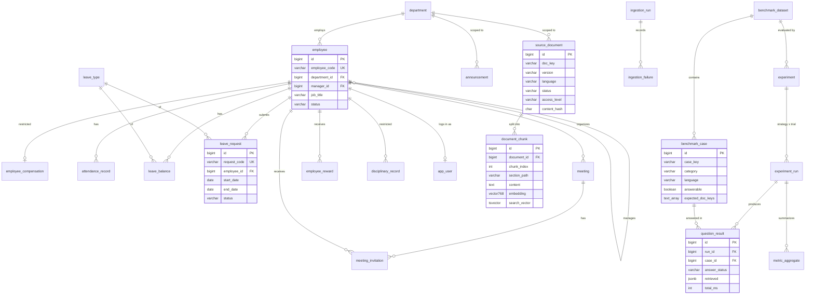

# Database Design

> Status: **design, validated as a draft**. The draft DDL was applied to `pgvector/pgvector:0.8.7-pg18-bookworm`
> (PostgreSQL 18.6) on 2026-11-10 (Task 0.3). Valid sample rows inserted; 11 constraint-violation tests were rejected as expected.
> It is **not** a Flyway migration yet. Tables become migrations in their milestones:
> HRIS tables in M2, documents/ingestion in M4, traces in M5, benchmark/experiments in M6 (minimal) and M9, `app_user` in M6.

## 1. Conventions

| Convention | Choice | Reason |
|---|---|---|
| Primary keys | `BIGSERIAL id` | Simple joins; JPA-friendly |
| Business keys | Separate `UNIQUE` codes (`E-1001`, `LR-1005`, `M-0042`, `POL-ANNUAL-LEAVE-EN`) | Stable IDs used by questions, tools, benchmark labels and citations; independent of generated IDs |
| Enumerations | `VARCHAR` + `CHECK (... IN (...))` | Easier with JPA than PostgreSQL enums; extended by a migration |
| Time | `TIMESTAMPTZ` for instants, `DATE` for calendar days | Avoids timezone bugs in attendance and meetings |
| Derived values | Not stored (e.g. remaining leave = entitled − used − pending) | Single source of truth |
| Trace and result detail | `JSONB` (retrieved chunks, citations, tool calls, guardrails) | Always read as a unit. Filterable fields (status, strategy, timings, tokens) are real columns. |
| Schema owner | Flyway only; Hibernate `ddl-auto=validate` | Decision D2 |

## 2. Entity-relationship diagram

`rag_request_trace` (chat playground traces) is standalone. It stores `username` and `strategy`, but no foreign keys, so
traces survive a reseed of the synthetic data.

## 3. Tables

### 3.1 HRIS (Milestone 2)

| Table | Key columns and constraints | Notes |
|---|---|---|
| `department` | `code` UK, `name_en`, `name_ar` | ~10 rows |
| `employee` | `employee_code` UK, `email` UK (synthetic `@example.test`), FK `department_id`, self-FK `manager_id` (≠ own id), `employment_type`, `status` | ~500 rows |
| `employee_compensation` | PK = FK `employee_id`, `monthly_salary > 0` | **Restricted (HR_ADMIN only).** Exists so salary-disclosure attacks have a real target. Never embedded or indexed for RAG. |
| `attendance_record` | UK (`employee_id`, `work_date`), `minutes_late ≥ 0`, `check_out > check_in`, status | ~5,000 rows |
| `leave_type` | `code` UK (ANNUAL, SICK, …), bilingual names, default days | |
| `leave_balance` | UK (`employee_id`, `leave_type_id`, `year`); entitled / used / pending ≥ 0 | Remaining is computed |
| `leave_request` | `request_code` UK, `end_date ≥ start_date`, `days > 0`; `decided_at` is set **iff** status ∈ {APPROVED, REJECTED} | ~1,000 rows |
| `meeting` | `meeting_code` UK, `ends_at > starts_at`, `requires_approval`, status | ~500 rows |
| `meeting_invitation` | PK (`meeting_id`, `employee_id`), response, attended | |
| `employee_reward` | type CHECK, `awarded_on`, `awarded_by_id` | ~300 rows |
| `disciplinary_record` | action type CHECK, `issued_by_id` | **Restricted (HR_ADMIN, or the employee's direct manager).** |
| `announcement` | `announcement_code` UK; `scope = DEPARTMENT` ⇔ `department_id` is not null; `expires_at > published_at` | ~100 rows, bilingual |
| `app_user` | `username` UK, `employee_id` UK, `role` ∈ {EMPLOYEE, MANAGER, HR_ADMIN}, `max_access_level` | Simulated identities (M6) |

### 3.2 Documents and ingestion (Milestone 4)

| Table | Key columns and constraints | Notes |
|---|---|---|
| `source_document` | UK (`doc_key`, `version`); **partial unique index: one `ACTIVE` row per `doc_key`**; status ∈ {ACTIVE, SUPERSEDED, DRAFT}; `access_level` ∈ {PUBLIC, INTERNAL, CONFIDENTIAL}; `content_hash` SHA-256 | One row per version. The authoritative version is the single ACTIVE one. The hash drives "skip unchanged" re-ingestion. |
| `document_chunk` | UK (`document_id`, `chunk_index`); `embedding vector(768)`; `embedding_model`; `search_vector` **generated** with `arabic` or `english` config chosen by `language`; HNSW (cosine) and GIN indexes | Citations come from `doc_key` + `version` + `section_path` / `page_number` |
| `ingestion_run` | status ∈ {RUNNING, SUCCEEDED, PARTIAL, FAILED}; `config` JSONB; counters | |
| `ingestion_failure` | FK run; `stage` ∈ {LOAD, EXTRACT, NORMALIZE, CHUNK, EMBED, STORE}; message | Failures are rows, never silently dropped |

**Access and version filtering happens inside the retrieval SQL** (join to `source_document`, filtering `status = 'ACTIVE'` and
`access_level` ≤ the user's maximum), so restricted text never reaches the application or the LLM.

### 3.3 Benchmark (Milestone 3 file, then loaded in M6/M9)

| Table | Key columns and constraints | Notes |
|---|---|---|
| `benchmark_dataset` | UK (`name`, `version`); `checksum` of the source file | Detects silent edits to a published dataset version |
| `benchmark_case` | UK (`dataset_id`, `case_key`); `language` ∈ {en, ar, ar-eg, mixed}; `category` ∈ the six spec categories; `answerable`; `expected_answer`; `expected_doc_keys TEXT[]`; `expected_tool`; `expected_auth_outcome`; `asking_username`; **an unanswerable case cannot list expected docs** | Labels live only here, never in the document tables or `RagQuery` |

### 3.4 Experiments (minimal in M6, complete in M9)

| Table | Key columns and constraints | Notes |
|---|---|---|
| `experiment` | FK dataset; status ∈ {QUEUED, RUNNING, COMPLETED, PARTIAL, FAILED, CANCELLED}; `config` JSONB snapshot | Config includes models, settings, corpus `ingestion_run` ID and app version. **No secrets.** |
| `experiment_run` | UK (`experiment_id`, `strategy`, `trial`); `settings` JSONB = `RagSettings` as executed | One run per strategy per trial |
| `question_result` | **UK (`run_id`, `case_id`)**, so runs are resumable and idempotent; status; answer; JSONB citations / retrieved / tool calls / guardrails / per-question metrics; timing, call and token columns including `thinking_tokens`; `estimated_cost_usd`; `error_message` | Raw results are persisted, so metrics can be recomputed |
| `metric_aggregate` | UK (`run_id`, `metric`, `slice_type`, `slice_value`); `slice_type` ∈ {ALL, LANGUAGE, CATEGORY}; `sample_size` | Per-language and per-category breakdowns without recomputation |

### 3.5 Request traces (Milestone 5)

| Table | Contents | Not stored |
|---|---|---|
| `rag_request_trace` | `request_id` UUID UK, `conversation_id`, `username`, `strategy`, `question`, status, `answer`, `prompt_template_version`, `trace` JSONB (retrieval, citations, summarized tool calls, guardrails, usage, timings), `created_at` (indexed for retention cleanup) | API keys; full system prompt text (only its version); raw tool payloads containing personal data. The retention period is decided in M5. |

## 4. Validation evidence (draft DDL, Task 0.3)

Result: 24 tables and 54 indexes created with no errors.

| Probe | Result |
|---|---|
| P1 Valid HRIS rows across all HRIS tables | PASS |
| P2 Remaining annual leave for E-1001 (21 − 6 − 2) | PASS → 13.0 |
| N1 `end_date < start_date` | PASS (rejected: check_violation) |
| N2 Duplicate `request_code` | PASS (rejected: unique_violation) |
| N3 APPROVED without `decided_at` | PASS (rejected: check_violation) |
| N4 Two attendance rows for the same employee and day | PASS (rejected: unique_violation) |
| N5 Employee with unknown department | PASS (rejected: foreign_key_violation) |
| N6 DEPARTMENT announcement without department | PASS (rejected: check_violation) |
| N7 Meeting ending before it starts | PASS (rejected: check_violation) |
| N8 Second ACTIVE version of the same `doc_key` | PASS (rejected: unique_violation) |
| N9 384-dim vector in `vector(768)` | PASS (rejected: "expected 768 dimensions, not 384") |
| N10 Unanswerable case listing expected docs | PASS (rejected: check_violation) |
| N11 Duplicate (`run_id`, `case_id`) result | PASS (rejected: unique_violation) |
| P4 Generated `search_vector` with per-row `CASE language` config | PASS (accepted as immutable; English rows stemmed with `english`, Arabic with `arabic`) |
| P5 Vector top-K joined with status + access filter, user max = INTERNAL | PASS: returned only ACTIVE INTERNAL chunks; SUPERSEDED v1.0, DRAFT and CONFIDENTIAL chunks excluded |
| P6 Keyword search: `الاجازه المرضيه` vs chunk "الإجازة المرضية" | **No match.** See §5 |
| P7 Dataset → case → experiment → run → result → aggregates chain | PASS |

## 5. Findings to carry forward

1. **Arabic taa-marbuta with the "ال" prefix (corrects §1.4 of `architecture.md`).** `مرضيه` → `مرض`, but `المرضيه` → `مرضيه`
   (no match against `المرضية` → `مرض`). The same holds for `الاجازه`, `السنويه` and `الاداريه`. Egyptian users commonly type ه for ة.
   *Mitigation to evaluate in M7:* an `IMMUTABLE` normalization function (ة→ه, alef variants, tatweel, diacritics), applied
   identically to the indexed text and the query, then measured on the benchmark.
2. **Filtered HNSW search is not yet proven at scale.** With 5 rows the planner sorted instead of using HNSW. With HNSW plus a
   `WHERE` filter, pgvector filters *after* the index scan, so a selective filter can return fewer than K rows. pgvector 0.8
   provides `hnsw.iterative_scan`. *Action in M5/M10:* test with the real corpus (~thousands of chunks), compare against exact search
   for recall, and enable iterative scan if under-filling occurs.
3. **Normalized vs denormalized chunk filters.** Access level and status are read through the join (no duplicated columns).
   Denormalize only if M10 measurements show the join is a bottleneck.
